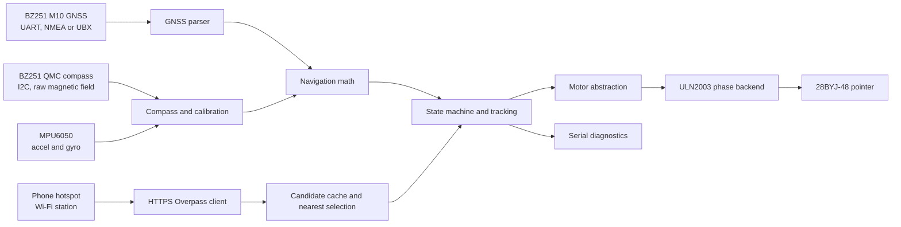

# BoozeCompass

**ESP32-C3 destination pointer with GNSS, magnetic heading, and a geared stepper.**

BoozeCompass reads its position from a BZ251 GNSS module, obtains magnetic field measurements from the module's I2C compass, and uses a separate MPU6050 for tilt compensation and motion measurements. Over a phone hotspot it asks OpenStreetMap's Overpass API for mapped alcohol and wine shops, chooses the nearest returned candidate, and computes a pointer angle. The pointer is driven by a 5 V 28BYJ-48 through a ULN2003 board.

The firmware is native C on ESP-IDF. It defaults to motor dry-run and will not automatically energize the motor or assume a physical zero at boot. Serial diagnostics report when the device cannot trust its fix, compass calibration, network, or cached destination.

> **Motor compatibility:** the five-wire 28BYJ-48 is unipolar. The A4988 is a bipolar driver and must not be connected to this unmodified motor. This firmware targets a ULN2003 board.

## Features

- NMEA 0183 and UBX NAV-PVT GNSS parsing over UART, fix checks, satellite count, position age, altitude, and speed.
- QMC5883-family magnetometer driver on I2C, with configurable address, hard-iron offsets, per-axis soft-iron scale, and a calibration routine.
- MPU6050 accelerometer and gyroscope driver with configurable sample/range settings, filtering, tilt, and stationary gyro-bias calibration.
- Tilt-compensated magnetic heading; east-positive magnetic declination is applied once when deriving true heading.
- Haversine distance, initial bearing, wrap-safe angles, cache freshness checks, and a pointer-zero correction.
- HTTPS Overpass searches with certificate-bundle verification, bounded response memory, a named User-Agent, duplicate filtering, and a conservative request interval.
- ULN2003 half-step backend behind a motor interface; open-loop angle estimates, acceleration ramp, safe-disable, manual zero confirmation, and dry-run.
- Explicit system states, serial diagnostics, reconnection and sensor-recovery handling.
- Host-side tests for geographic math, stale data, store selection/deduplication, and motor angle conversion.

## Architecture

See [architecture](docs/architecture.md) for state transitions and task behavior.

## Hardware inventory and compatibility

| Part | Project configuration |
|---|---|
| Controller | ESP32-C3 development board; exact board/revision must be confirmed before wiring |
| GNSS/compass | BZ251-family M10 GNSS module; UART for GNSS and I2C for the compass on the manual variant |
| Compass | BZ251 manufacturer material describes QMC5883; firmware defaults to the manual's 0x0C address and allows 0x0D as an override |
| IMU | MPU6050 6-axis accelerometer/gyroscope on the shared I2C bus |
| Motor | Five-wire 5 V 28BYJ-48 unipolar geared stepper |
| Driver | ULN2003-compatible four-phase board; do not use the A4988 with the unmodified motor |

The BZGNSS product listing identifies the BZ251 as u-blox M10050 with QMC5883; the BZ251 manual lists UART, NMEA and UBX protocols, 38400 baud, a 3.0–5.5 V module supply, and 3.3 V digital I/O. The actual module label, board revision, UART baud, compass identity/address, and pull-up voltage still need physical confirmation. The software parses both common GNSS output formats; it does not configure the receiver.

The A4988 manufacturer's datasheet specifies bipolar stepper operation. The ULN2003 backend is the selected build configuration for the unmodified unipolar motor. Detailed assumptions and first-boot precautions are in [hardware compatibility](docs/hardware_compatibility.md).

## Wiring

The repository defaults use a reference ESP32-C3-DevKitM-1 pin map. They are **provisional** because the exact board in this project has not been identified. Confirm every GPIO against the board schematic and silkscreen before connecting hardware. Edit pins in menuconfig under BoozeCompass.

| ESP32-C3 default | Connection |
|---|---|
| GPIO4 | I2C SDA to BZ251 SDA and MPU6050 SDA |
| GPIO5 | I2C SCL to BZ251 SCL and MPU6050 SCL |
| GPIO6 / UART1 RX | BZ251 TX |
| GPIO7 / UART1 TX | BZ251 RX |
| GPIO0 | ULN2003 IN1 |
| GPIO1 | ULN2003 IN2 |
| GPIO3 | ULN2003 IN3 |
| GPIO10 | ULN2003 IN4 |
| 3V3 logic reference | MPU6050 breakout, only if its board supports 3.3 V supply |
| 5 V motor rail | ULN2003 VCC and 28BYJ-48 common lead through the board |
| Common GND | ESP32-C3, BZ251, MPU6050, ULN2003, and motor supply |

Use an I2C pull-up to **3.3 V**, never 5 V on ESP32-C3 pins. The firmware disables internal I2C pull-ups; use the sensor board's verified 3.3 V pull-ups or fit suitable external resistors. Do not connect 5 V motor power to an ESP GPIO. Complete wiring is in [docs/wiring.md](docs/wiring.md).

## Windows setup and build

This checkout was prepared against ESP-IDF **v5.2.8**, Python 3.11.2, and the Espressif RISC-V 13.2.0 toolchain on Windows PowerShell 5.1. The ESP-IDF PowerShell shortcut installed by Espressif is the easiest way to get its matching environment. A regular PowerShell session may block scripts; the shortcut launches with the required execution-policy bypass.

In an activated ESP-IDF PowerShell terminal:

    Set-Location "$env:USERPROFILE\Desktop\BoozeCompass"
    idf.py set-target esp32c3
    idf.py menuconfig
    idf.py build
    idf.py -p COM5 flash
    idf.py -p COM5 monitor

Replace COM5 with the board's port. In menuconfig, set the hotspot SSID/password, verify all GPIO choices, and review the Overpass and sensor settings. The generated sdkconfig contains local settings and is ignored by Git. Keep it private.

On this machine, activation is also available from PowerShell with the Espressif installer:

    powershell.exe -ExecutionPolicy Bypass -NoProfile
    . C:\Espressif\Initialize-Idf.ps1 -IdfId esp-idf-6dce30f5bfd7d7db2f0573e74d784ece
    Set-Location "$env:USERPROFILE\Desktop\BoozeCompass"
    idf.py set-target esp32c3

The IDF identifier is specific to this installation. Use the supplied ESP-IDF PowerShell shortcut on another machine. More detail: [Windows setup](docs/setup_windows.md).

## Configuration

Use idf.py menuconfig → **BoozeCompass** to set:

- Hotspot credentials (stored in local sdkconfig, not committed).
- UART/I2C pins, GNSS baud, compass address, I2C clock, magnetic declination, and sensor mounting correction.
- Search radius, HTTPS endpoint, refresh interval, and sensor age limits.
- Motor GPIOs, measured half-steps/revolution, direction, pointer-zero correction, speed, and acceleration.
- Motor enable and dry-run flags.

The project defaults to a 5 km search radius and 30-minute refresh interval to limit requests to public Overpass infrastructure. Manual and movement-triggered searches use the same minimum 15-minute request interval. Search responses are held in RAM; no location history or target is persisted. Magnetometer calibration is stored in NVS.

Use sdkconfig.defaults.example as a safe starting point. Never commit sdkconfig, hotspot credentials, local calibration dumps, or build output.

## First boot and calibration

1. Build with motor dry-run enabled. Keep the motor supply disconnected.
2. Confirm the ESP32-C3 board model and revision, then confirm GPIO and logic levels.
3. Connect sensors and run scan_i2c. The MPU6050 should normally be at 0x68; the compass address is configurable, and the BZ251 manual's address note differs from the QMC5883L datasheet.
4. Place the compass away from the stepper, motor wiring, magnets, steel, and high-current wiring.
5. Run calibrate_gyro while the device is stationary.
6. Run calibrate_mag start, rotate and tilt the device for 30–60 seconds, then calibrate_mag finish. This computes axis min/max hard-iron offsets and diagonal scale. It is not a substitute for validating orientation against known bearings.
7. Configure declination for the operating region. East is positive; firmware converts magnetic heading to true heading once.
8. Manually align the pointer with the device's forward axis, issue motor_zero confirm, then motor_arm. In dry-run, verify target angles first.
9. After confirming the motor wiring, set BC_MOTOR_ENABLE=y and BC_MOTOR_DRY_RUN=n, rebuild, and test in a clear area with motor power available.

Detailed steps and the pointer-offset sign convention: [calibration guide](docs/calibration.md).

## Serial commands

| Command | Action |
|---|---|
| status | State, sensor ages, network, target freshness, and motor estimate |
| scan_i2c | Diagnostic 7-bit address scan |
| gps, compass, imu | Sensor snapshots |
| search | Request a fresh search when GPS, Wi-Fi, and rate limit permit |
| calibrate_gyro | Estimate stationary MPU6050 gyro bias |
| calibrate_mag start / calibrate_mag finish | Collect and save magnetometer calibration |
| motor_zero confirm | Set estimated motor zero after manual pointer alignment |
| motor_arm / motor_disable | Arm or disarm motor commands |
| motor_test degrees | Move to an absolute pointer angle in [-360, 360] |
| help | Show commands |

Invalid or stale sensor data inhibits automatic motor updates. A cached destination is reported as stale and is no longer tracked after its age limit.

## Tests and implementation status

Run host tests from PowerShell:

    powershell.exe -ExecutionPolicy Bypass -NoProfile -File .\tools\run_host_tests.ps1

idf.py build validates the ESP-IDF target. See [testing](docs/testing.md) for coverage and limits.

**Implemented:** native ESP-IDF app and components, GNSS NMEA/UBX parsers, QMC5883-family raw driver, MPU6050 driver, navigation math, HTTPS Overpass client, Wi-Fi station manager, ULN2003 backend, serial state/diagnostics, dry-run, host tests.

**Build verified here:** ESP-IDF v5.2.8, target esp32c3; idf.py build completed successfully with the checked-in 4 MB partition layout. Host navigation and motor-math tests also pass. This is compile and host-test evidence, not hardware validation.

**Not hardware-verified:** the exact C3 board/pin breakout, BZ251 revision and compass silicon/address, actual pull-up rail, sensor mounting axes, magnetic calibration, motor step count, torque, physical direction, GPS fix, hotspot access, and Overpass service behavior on the device. There is no encoder or homing switch, so physical motor position and missed steps cannot be detected.

See [troubleshooting](docs/troubleshooting.md) and [hardware compatibility](docs/hardware_compatibility.md).

## References

- [BZGNSS BZ251 product manual](https://manuals.plus/bzgnss/bz251-gps-module-manual.pdf)
- [BZGNSS BZ251 product listing](https://bzgnss.com/products/bzgnss-gps-%E5%B8%A6%E6%8C%87%E5%8D%97%E9%92%88%E7%94%A8%E4%BA%8E%E6%82%AC%E5%81%9C-121-181-251m10-%E8%8A%AF%E7%89%87%E9%80%82%E7%94%A8%E4%BA%8E-f405-f722-%E9%A3%9E%E8%A1%8C%E6%8E%A7%E5%88%B6%E7%B3%BB%E7%BB%9Finav-%E9%80%82%E7%94%A8%E4%BA%8E%E5%9B%BA%E5%AE%9A%E7%BF%BC-fpv%E3%80%81rc-%E6%97%A0%E4%BA%BA%E6%9C%BA)
- [QST QMC5883L datasheet](https://www.qstcorp.com/upload/pdf/202202/%EF%BC%88%E5%B7%B2%E4%BC%A0%EF%BC%8913-52-04%20QMC5883L%20Datasheet%20Rev.%20A%281%29.pdf)
- [TDK InvenSense MPU6050 register map](https://invensense.tdk.com/wp-content/uploads/2015/02/MPU-6000-Register-Map1.pdf)
- [ESP-IDF 5.2 ESP32-C3 I2C master driver](https://docs.espressif.com/projects/esp-idf/en/v5.2/esp32c3/api-reference/peripherals/i2c.html)
- [ESP-IDF 5.2 HTTP client TLS verification](https://docs.espressif.com/projects/esp-idf/en/v5.2/esp32/api-reference/protocols/esp_http_client.html)
- [ESP32-C3-DevKitM-1 reference board guide](https://docs.espressif.com/projects/esp-idf/en/v5.0/esp32c3/hw-reference/esp32c3/user-guide-devkitm-1.html)
- [Allegro A4988 datasheet](https://www.allegromicro.com/-/media/files/datasheets/a4988-datasheet.pdf)
- [OpenStreetMap Overpass API usage guidance](https://wiki.openstreetmap.org/wiki/Overpass_API)
